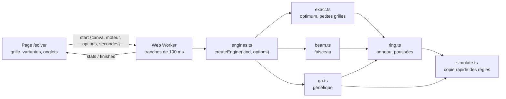
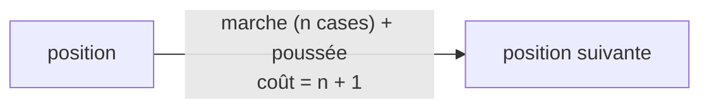
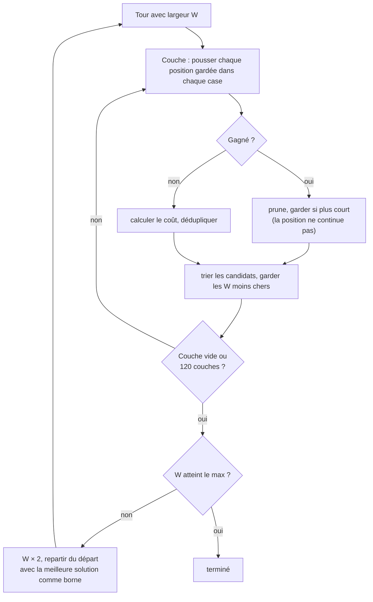
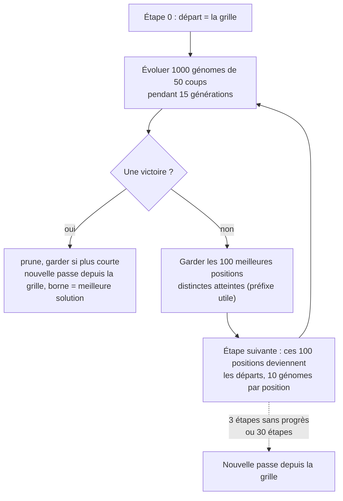
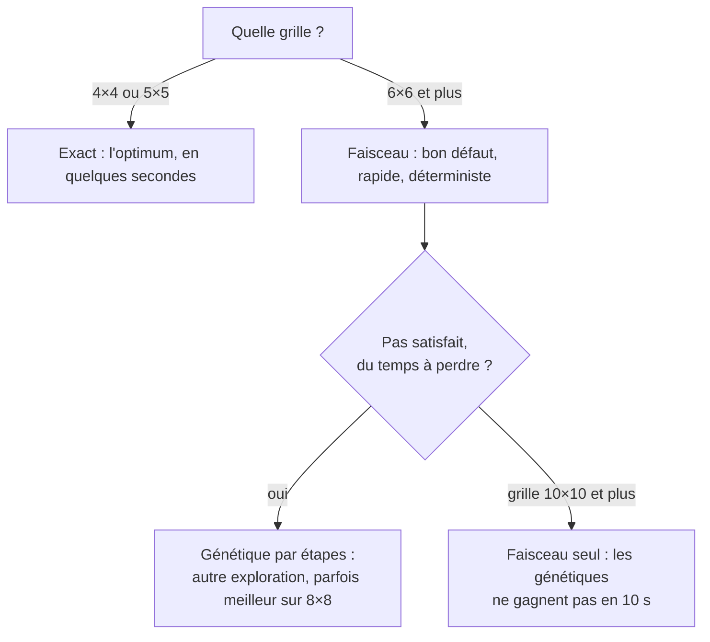

# Le solveur de switch, en détail

Ce document explique comment chaque méthode de recherche du solveur fonctionne, avec des exemples tirés de vraies exécutions du code (grilles de référence `4x4:a` et `6x6:a`, voir `lib/solver/benchGrids.ts`). Le résumé court et les décisions de conception sont dans [ARCHITECTURE.md](ARCHITECTURE.md), section 9.

Sommaire

1. [Vue d'ensemble](#1-vue-densemble)
2. [Le terrain : grille, anneau, poussée](#2-le-terrain--grille-anneau-poussée)
3. [Les briques communes](#3-les-briques-communes)
4. [Méthode 1 : la recherche exacte](#4-méthode-1--la-recherche-exacte)
5. [Méthode 2 : le faisceau](#5-méthode-2--le-faisceau)
6. [Méthode 3 : l'algorithme génétique](#6-méthode-3--lalgorithme-génétique)
7. [Méthode 4 : le génétique à gènes de poussée](#7-méthode-4--le-génétique-à-gènes-de-poussée)
8. [Comparer et choisir](#8-comparer-et-choisir)
9. [Reproduire](#9-reproduire)

---

## 1. Vue d'ensemble



Tous les moteurs répondent au même contrat : `step()` fait un petit morceau de travail (une couche, une génération, ou tout pour l'exact) et renvoie des statistiques (`GAStats` : tuiles restantes, coups, meilleure solution…). Le worker appelle `step()` en boucle, par tranches de 100 ms, et envoie le résultat à la page.

| Moteur | Id dans la page | Garantie | Taille de grille |
|---|---|---|---|
| Exact | `exact` | Optimum prouvé | jusqu'à 5×5 |
| Faisceau | `beam` | Aucune, mais déterministe et rapide | toutes (testé jusqu'à 10×10) |
| Génétique par étapes | `ga-staged` (+ variantes) | Aucune, aléatoire reproductible | jusqu'à 8×8 |
| Génétique à une étape | `ga-single` | Aucune | jusqu'à 6×6 |
| Génétique, gènes de poussée | `ga-push` | Aucune | jusqu'à 8×8 |

---

## 2. Le terrain : grille, anneau, poussée

Exemple : la grille `4x4:a`. Les chiffres 1 à 4 sont les couleurs. Le curseur (`[1]`) démarre dans le coin bas gauche, de l'autre côté du bord, avec une tuile « en main ».

```
 ·  ·  ·  ·  ·  ·          y = 5   bord haut
 ·  4  4  1  1  ·          y = 4
 ·  3  1  2  2  ·          y = 3
 ·  4  1  3  2  ·          y = 2
 ·  1  3  2  3  ·          y = 1
[1] ·  ·  ·  ·  ·          y = 0   bord bas
x=0 1  2  3  4  5
```

Le curseur ne se promène que sur **l'anneau** : les cases `·` autour de la grille. Deux types de coups :

- **Marcher** le long de l'anneau (haut, bas, gauche, droite) : le curseur bouge d'une case, la grille ne change pas. Un coup compté.
- **Pousser** vers l'intérieur depuis une case de bord : la tuile en main entre dans la ligne ou la colonne, tout se décale, la tuile qui sort à l'autre bout devient la nouvelle tuile en main, et le curseur saute au bord opposé. Un coup compté.

Après chaque poussée, toute ligne ou colonne d'une seule couleur disparaît, et le jeu est gagné quand il ne reste qu'une ligne ou une colonne. Le score est le nombre de coups : on cherche la liste de coups la plus courte.

### Numérotation de l'anneau (4×4, 20 cases)

Les cases sont numérotées dans le sens horaire depuis le coin bas gauche. Les coins (0, 5, 10, 15) ne sont pas des points de poussée. Les 16 autres sont des **cases de poussée** (slots).

```
 15  14  13  12  11  10
 16   .   .   .   .   9
 17   .   .   .   .   8
 18   .   .   .   .   7
 19   .   .   .   .   6
  0   1   2   3   4   5
```

Une grille 8×8 a 36 cases d'anneau et 32 cases de poussée.

### Une poussée, en vrai

Premier coup de la solution optimale de `4x4:a`. Le curseur monte d'une case le long du bord gauche (`u`), puis pousse vers la droite (`r`) dans la rangée du bas :

```
avant                          après
 ·  ·  ·  ·  ·  ·              ·  ·  ·  ·  ·  ·
 ·  4  4  1  1  ·              ·  4  4  1  1  ·
 ·  3  1  2  2  ·              ·  3  1  2  2  ·
 ·  4  1  3  2  ·              ·  4  1  3  2  ·
[1] 1  3  2  3  ·              ·  1  1  3  2 [3]
 ·  ·  ·  ·  ·  ·              ·  ·  ·  ·  ·  ·
```

Le 1 entre par la gauche, la rangée `1 3 2 3` devient `1 1 3 2`, le 3 qui sort par la droite est maintenant en main, et le curseur est passé au bord droit.

---

## 3. Les briques communes

### 3.1 Le simulateur (`simulate.ts`)

La vraie machine de jeu (xstate) clone tout son contexte à chaque coup : bien trop lent pour jouer des millions de coups. `simulate.ts` refait les mêmes règles sur un tableau à plat (`Uint8Array`) modifié sur place. Un test rejoue des milliers de coups aléatoires dans les deux et compare tout après chaque coup : si la règle du jeu change, ce test casse tant que le simulateur n'est pas mis à jour.

### 3.2 Poussées plutôt que coups (`ring.ts`)

Marcher ne change pas la grille. Donc une partie, c'est toujours : *marcher, pousser, marcher, pousser…* Et entre deux poussées, la marche optimale est toujours **le chemin le plus court sur l'anneau**.



Les moteurs « poussées » (exact, faisceau, génétique à gènes de poussée) cherchent donc seulement **où pousser** (une case parmi 16 en 4×4, 32 en 8×8), et paient la marche comme un coût. On ne perd aucune solution (un test compare l'optimum trouvé ainsi à une recherche exhaustive coup par coup) et tous les détours inutiles du curseur disparaissent.

Exemple, solution optimale de `4x4:a` (10 coups) décomposée :

| # | Marche | Poussée | Coût | Effet |
|---|---|---|---|---|
| 1 | `u` | `r` | 2 | rangée du bas décalée |
| 2 | `uuu` | `l` | 4 | une colonne uniforme (les 1) **disparaît** : 4×4 → 4×3 |
| 3 | `d` | `r` | 2 | rien ne disparaît |
| 4 | `u` | `l` | 2 | **deux colonnes** uniformes disparaissent à la suite : 4×3 → 4×1, gagné |

Total 2 + 4 + 2 + 2 = 10 coups. Seulement 4 poussées : les 6 autres coups sont de la marche.

### 3.3 Le coût d'une position

Pour comparer des positions qui ne sont pas encore gagnées, tous les moteurs (sauf l'exact) utilisent le même coût, plus petit = meilleur :

```
coût = tileWeight × tuiles restantes  +  nearness  +  moveWeight × coups joués
         (8)                                                         (1)
```

**`nearness`** mesure à quel point on est proche de la prochaine ligne. Pour gagner il faut retirer `lignes − 1` rangées (ou `colonnes − 1` colonnes). Chaque ligne coûte ses tuiles qui ne sont pas de la couleur majoritaire de la ligne ; `nearness` est la somme des `n − 1` lignes les moins chères, en prenant le meilleur entre rangées et colonnes.

Exemple, la grille de départ de `4x4:a` :

```
 4 4 1 1   -> couleur majoritaire : 4 (ou 1), 2 tuiles en trop   coût 2
 3 1 2 2   -> majoritaire 2, 2 en trop                             coût 2
 4 1 3 2   -> aucune majorité, 3 en trop                           coût 3
 1 3 2 3   -> majoritaire 3, 2 en trop                             coût 2
```

Rangées (coûts 2, 2, 3, 2) : les 3 moins chères font 2 + 2 + 2 = 6. Colonnes (coûts 2, 2, 2, 2) : 6. `nearness = min(6, 6) = 6`. Coût de départ : 16 × 8 + 6 + 0 = **134**.

Pourquoi ce coût et pas seulement « tuiles restantes » : tant qu'aucune ligne ne disparaît, le nombre de tuiles ne bouge pas, et la recherche n'a aucune pente à suivre. `nearness` en donne une. Le long de la solution optimale de `4x4:a` :

| Coup | Tuiles | `nearness` | Coût |
|---|---|---|---|
| départ | 16 | 6 | 134 |
| 1 `u` | 16 | 6 | 135 |
| 2 `r` | 16 | 4 | 134 |
| 3, 4, 5 `uuu` | 16 | 4 | 135, 136, 137 |
| 6 `l` (colonne retirée) | 12 | 3 | **105** |
| 7 `d` | 12 | 3 | 106 |
| 8 `r` | 12 | 2 | 106 |
| 9 `u` | 12 | 2 | 107 |
| 10 `l` | gagné | | **10** |

On voit l'équilibre : le coût monte un peu pendant la marche (chaque coup coûte 1), puis chute quand une ligne disparaît (4 tuiles × 8 = 32 de moins). Avec un poids des coups trop fort (≥ 2), une marche longue avant une ligne n'est plus rentable pour le coût : on observe que la recherche bloque alors sur certaines grilles (voir la section 6.6), ce qui s'explique probablement ainsi.

### 3.4 Élagage, borne, déduplication

- **`prune`** : toute solution gagnante est nettoyée de ses détours. On retire toute suite de 1 à 8 coups dont la suppression garde la grille gagnée avec moins de coups, jusqu'à ce que plus rien ne puisse être retiré.
- **Borne** : dès qu'une solution de `M` coups est connue, toute position qui ne peut plus la battre est abandonnée (elle est écartée).
- **Déduplication** : une position (grille, curseur, tuile en main) est identifiée par une clé de hachage sur 52 bits (`stateKey`). Si on l'a déjà vue avec moins de coups, on ne la reprend pas.

---

## 4. Méthode 1 : la recherche exacte

**Idée.** Explorer *toutes* les positions dans l'ordre croissant du nombre de coups, sans jamais en visiter deux fois. La première victoire rencontrée est forcément la plus courte.

```
seau 0   seau 1   seau 2   seau 3   ...
[départ] [ . ]    [ a b ]  [ c d e]
   |        ↑         ↑        ↑
   └ poussées vers les seaux « coût actuel + marche + 1 »
```

On range les positions dans des seaux par coût cumulé (0, 1, 2, …). On vide le seau 0, puis le 1, etc. Chaque position dépilée est poussée dans chacune des cases de poussée, ce qui crée des positions dans des seaux plus loin (la marche rend les coûts inégaux, d'où des seaux et non une file simple). Si une position est déjà connue à moindre coût, on l'ignore. Dès qu'on dépile une position gagnante, c'est l'optimum.

**Exemple : `4x4:a`.** L'optimum, 10 coups, est trouvé en développant **445 positions** (15 ms). Pour `4x4:b` : 2 870 positions, optimum 13. En 5×5 : environ 75 000 positions, 4 secondes, optimum 18. Au-delà, le nombre de positions explose et l'exact abandonne à `maxNodes` en donnant une **borne basse** (« toute solution demande au moins N coups »).

| Option | Défaut | Effet |
|---|---|---|
| `maxNodes` | 2 000 000 (3 M dans le banc d'essai) | Nombre de positions développées avant d'abandonner |

**À quoi il sert.** À mesurer les autres : sur 4×4 et 5×5, on sait à combien de coups de l'optimum chaque heuristique est. Il n'est pas fait pour résoudre une grille de jeu normale.

---

## 5. Méthode 2 : le faisceau

**Idée.** Même exploration qu'en largeur, mais on ne garde à chaque couche que les `W` positions les moins chères. On renonce à la garantie pour tenir sur de grandes grilles.

```
couche 0      1 position (le départ)
                 │  × 24 cases de poussée (6×6)
couche 1     24 candidats  ──tri par coût──►  on garde les W meilleurs
                 │  × 24
couche 2    W × 24 candidats ──tri, dédup──►  on garde les W meilleurs
                 │  ...
couche k    ... une poussée gagnante : on note la solution (si plus courte)
```



**Les tours.** La largeur démarre à 25 et **double à chaque tour** (25, 50, 100, 200, 400, …, 25 600). Un petit tour donne vite une première solution ; les tours suivants, plus larges, cherchent mieux avec la solution courante comme borne. Le résultat est **déterministe** : même grille, même solution.

### Exemple réel : `6x6:a`

Une grille 6×6 a 24 cases de poussée, donc avec `W = 25`, jusqu'à 600 candidats par couche (moins après déduplication) pour 25 gardés.

**Tour 0 (largeur 25)** : tuiles restantes et `nearness` du meilleur candidat de chaque couche.

| Couche | 1 | 2 | 3 | 4 | 5 | 6 | 7 | 8 | 9 | 10 | 11 | 12 | 13 |
|---|---|---|---|---|---|---|---|---|---|---|---|---|---|
| Tuiles | 36 | 36 | 30 | 30 | 30 | 30 | 25 | 20 | 16 | 15 | 12 | 4 | **2** |
| `nearness` | 13 | 10 | 13 | 11 | 10 | 9 | 8 | 7 | 5 | 4 | 3 | 1 | **0** |

Chaque ligne retirée fait baisser les tuiles ; entre deux, c'est `nearness` qui descend. À la couche 13 une poussée gagne : **53 coups** (après `prune`), en une fraction de seconde. Une couche de plus du même tour descend à **49**.

**Tours suivants** (la solution courante sert de borne) :

| Tour | Largeur | Meilleure solution |
|---|---|---|
| 0 | 25 | 53, puis 49 |
| 1 | 50 | 45, puis **40** |
| 2 | 100 | 40 (pas mieux) |
| 3 | 200 | **37** |
| 4, 5… | 400, 800… | 37 (pas mieux) |

Le benchmark à 10 s donne 32 coups pour cette grille : les tours plus larges, avec le temps, améliorent encore.

| Option | Défaut | Effet |
|---|---|---|
| `startWidth` | 25 | Largeur du premier tour |
| `maxWidth` | 25 600 | Largeur du dernier tour, puis le moteur s'arrête (`done`) |
| `maxLayers` | 120 | Poussées maximum par solution |
| `tileWeight`, `moveWeight` | 8, 1 | Le coût de la section 3.3 |

**Forces.** Rapide (première solution en moins de 0,3 s partout, même en 10×10), déterministe, le seul à gagner en 10×10 dans le benchmark.
**Faiblesses.** Il garde seulement les moins chères : si le bon chemin passe par une position qui semble mauvaise à court terme, il est perdu pour toujours. Il n'a aucune diversité. En 10×10 les solutions (147 à 217 coups) sont sûrement loin de l'optimum, parce que `nearness` y devient un guide trop grossier.

---

## 6. Méthode 3 : l'algorithme génétique

**Idée.** Au lieu d'explorer méthodiquement, on fait évoluer une population de listes de coups « au hasard » en gardant les meilleures, comme une sélection naturelle.

### 6.1 Le génome

Un génome est une suite de `length` coups (0 à 3 = `u`, `r`, `d`, `l`). Un coup impossible dans la position (par exemple descendre depuis le bord bas) est simplement ignoré par le jeu : tout génome est donc valide, il n'y a rien à réparer.

### 6.2 L'évaluation et le « préfixe utile »

On joue le génome, et pour chaque coup accepté on calcule le coût de la section 3.3. La valeur du génome est **le meilleur coût atteint en cours de route**, et son *préfixe utile* est le nombre de gènes joués jusque-là ; la suite du génome (la queue) ne compte pas, elle peut dériver librement. Une victoire vaut le nombre de coups joués, ce qui est toujours meilleur qu'une position non gagnée.

Exemple, un génome tiré au hasard sur `4x4:a` (départ : coût 134) :

```
uldlulruulldrddllrrlrrud
1:u ok  coups 1  tuiles 16 near 6  coût 135
2:l ignoré
3:d ok  coups 2  tuiles 16 near 6  coût 136
...
7:r ok  coups 4  tuiles 16 near 4  coût 136
...
```

Aucun coup ne descend sous 134 : le préfixe utile est **vide**, ce génome ne vaut rien. C'est le cas de presque tous les génomes aléatoires, d'où l'importance d'une population de plusieurs centaines et de la sélection.

### 6.3 Sélection, croisement, mutations

À chaque génération :

1. **Élite** : les 2 % meilleurs passent tels quels.
2. **Sélection par tournoi** : on tire 3 génomes au hasard, le meilleur devient parent.
3. **Croisement** (une fois sur deux) : le début d'un parent, la fin d'un autre, coupés dans le préfixe utile du premier. Seulement si les deux partent de la même position (voir 6.4).
4. **Mutations** (1 à 4 par enfant), dans le préfixe utile ou dans la queue (50/50) :

| Mutation | Part | Exemple (illustration) |
|---|---|---|
| Changer un coup | 45 % | `u r r d l u` → `u r **l** d l u` |
| Insérer un coup | 25 % | `u r r d l u` → `u r **d** r d l` (la queue glisse à droite, le dernier coup tombe) |
| Supprimer un coup | 20 % | `u r r d l u` → `u r d l u **r**` (la queue glisse à gauche, un coup aléatoire entre à la fin) |
| Refaire 2 à 8 coups | 10 % | `u r r d l u` → `u **d d l** l u` |

Les mutations gardent la tête du génome et ne changent que ce qui suit, pour ne pas défaire un progrès déjà acquis.

### 6.4 Le génétique par étapes

Un seul génome de 100 coups contre une grille 8×8 est trop dur. On résout donc la partie **par morceaux de 50 coups** :



C'est un faisceau où l'expansion est faite par un petit algorithme génétique plutôt que par toutes les poussées. Les génomes d'une étape ne se croisent qu'entre génomes qui partent de la **même position** (une suite de coups n'a de sens que depuis sa position de départ).

**Exemple réel, `6x6:a`** (1000 génomes, 50 coups, 30 étapes) :

| Génération | Étape | Meilleur génome |
|---|---|---|
| 0 | 0 | 30 tuiles, `nearness` 13, 16 coups |
| 16 | 1 | 20 tuiles, `nearness` 7, 45 coups (cumulés depuis la grille) |
| 31 | 2 | **victoire, 44 coups** |

Soit 31 générations, environ une seconde.

### 6.5 Le génétique à une étape

Avec `maxStages = 1`, il n'y a qu'une étape qui ne se termine jamais d'elle-même : un seul grand génome évolue jusqu'à ce qu'on l'arrête (une victoire relance une nouvelle passe qui doit faire plus court). Plus simple, mais il ne gagne pas en 8×8 en 10 s dans le benchmark.

### 6.6 Réglages et effets mesurés

| Option | Défaut | Effet / constat |
|---|---|---|
| `population` | 1000 | Génomes par génération. Plus grand : plus de diversité, plus lent |
| `length` | 50 | Gènes par étape |
| `maxStages` | 30 | 1 = génétique simple ; sinon nombre d'étapes avant une nouvelle passe |
| `generations` | 15 | Générations par étape (30 ne change rien aux résultats) |
| `beam` | 100 | Positions gardées entre deux étapes (300 ne change rien) |
| `elite` | 2 % | Génomes conservés tels quels |
| `seed` | 1 | Graine : même graine et même grille, même run |
| `tileWeight` / `moveWeight` | 8 / 1 | Voir ci-dessous |
| `pushes` | non | Gènes de poussée (section 7) |

Effet du **poids des coups** (génétique par étapes, 4 grilles 8×8 d'un autre jeu) :

| `moveWeight` | Coups moyens |
|---|---|
| 0 | 126 |
| 0,5 | 106,5 |
| **1** | **99,5** |
| ≥ 2 | bloque certaines grilles (aucune victoire) |

Sans pénalité de coups, la recherche prend des chemins longs ; avec une pénalité trop forte, elle n'ose plus faire la marche nécessaire pour atteindre une ligne (voir le tableau de coûts en 3.3).

**Forces.** Peut sortir des pièges où le faisceau se coince, et gagne parfois mieux (`8x8:c` : 59 coups contre 66 pour le faisceau).
**Faiblesses.** Aléatoire, plus lent à la première solution (0,3 à 1,5 s), ne gagne plus en 10×10 en 10 s.

---

## 7. Méthode 4 : le génétique à gènes de poussée

**Idée.** Utiliser l'idée de la section 3.2 dans le génétique : un gène n'est plus un coup mais une **poussée**, la marche étant calculée. Un génome de 8 gènes représente donc 8 poussées, c'est-à-dire plusieurs dizaines de coups une fois la marche comptée.

**Encodage.** Un gène est un octet autour de 128. Il se lit comme une **distance signée sur l'anneau depuis le curseur** : `décalage = arrondi((gène − 128) / 128 × taille_anneau / 2)`. Le tirage est triangulaire autour de 128, donc les petites distances sont plus probables. Un décalage qui tombe sur un coin passe à la case de poussée suivante.

Exemple en `4x4:a`, curseur sur la case d'anneau 3 (bord bas), anneau de 20 cases :

| Gène | Décalage | Case d'anneau | Case de poussée | Coût de la marche |
|---|---|---|---|---|
| 128 | 0 | 3 | 2 (bord bas, pousse vers le haut) | 0 |
| 140 | +1 | 4 | 3 | 1 |
| 116 | −1 | 2 | 1 | 1 |
| 96 | −2 | 1 | 0 | 2 |
| 160 | +3 | 6 | 4 (bord droit, pousse vers la gauche) | 3 |
| 200 | +6 | 9 | 7 | 6 |

**Pourquoi relatif.** Une première version utilisait un numéro de case absolu : elle donnait de mauvais résultats (86 à 216 coups), parce que le numéro n'a plus de sens quand la grille rétrécit. Le décalage relatif, avec des étapes courtes (6 à 10 poussées), rattrape le génétique classique sans le dépasser ; avec des étapes longues (25 poussées) il reste moins bon.

| Option | Valeur utilisée | Remarque |
|---|---|---|
| `pushes` | oui | Active les gènes de poussée |
| `length` | 8 | Poussées par étape |

Il reste une option du moteur mais n'est pas le choix recommandé.

---

## 8. Comparer et choisir

Résultats du benchmark (10 s par moteur, coups de la meilleure solution) :

| Grille | Optimum | `ga-single` | `ga-staged` | `ga-push` | `beam` |
|---|---|---|---|---|---|
| 4×4 a / b | 10 / 13 | 10 / 13 | 10 / 13 | 10 / 13 | 10 / 13 |
| 5×5 a / b | 18 / 18 | 18 / 19 | 18 / 18 | 18 / 18 | 18 / 18 |
| 6×6 a / b / c | ? | 42 / 27 / 40 | 38 / 29 / 34 | 37 / 31 / 37 | **32 / 27 / 37** |
| 8×8 a / b / c / d | ? | aucune | 96 / 95 / **59** / 81 | 105 / 90 / 77 / 68 | **78 / 78** / 66 / **61** |
| 10×10 a / b | ? | aucune | aucune | aucune | **217 / 147** |



Limites de ces chiffres : une exécution par grille et par moteur, une seule machine, des écarts de quelques coups qui ne sont pas significatifs (par exemple entre `ga-staged` et `ga-push`). Au-delà de 5×5 on ne connaît pas l'optimum, donc on ne sait pas à quelle distance on est.

Pistes pour aller plus loin, déjà décrites dans [ARCHITECTURE.md](ARCHITECTURE.md) : réécrire par fenêtres de 8 à 12 coups la meilleure solution, améliorer `nearness` (il ignore la tuile en main et la marche vers la case utile), ajouter de la diversité au faisceau.

---

## 9. Reproduire

- **Dans le navigateur** : `npm run dev`, puis ouvrir `/solver`. L'onglet **Run** lance un moteur sur une grille et affiche les graphiques ; l'onglet **Benchmark** compare des variantes sur des grilles de référence et donne un tableau (avec un rapport texte à copier). Toutes les options de ce document y sont modifiables.
- **En ligne de commande** : `npm run solver:bench`, avec `SOLVER_SECONDS`, `SOLVER_GRIDS`, `SOLVER_ENGINES` et `SOLVER_OUT` pour régler le budget, filtrer, et écrire le rapport dans un fichier.
- **Tests** : `npx vitest run lib/solver` (simulateur contre la vraie machine, anneau, exact contre une recherche coup par coup, faisceau rejoué dans la vraie machine).
